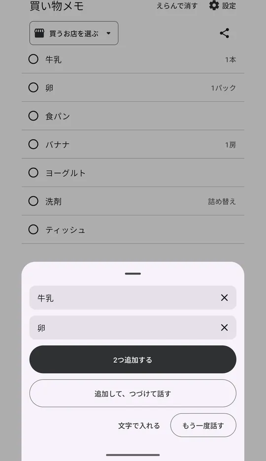
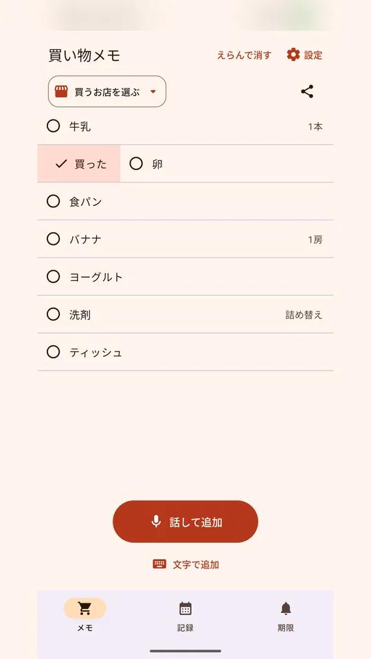
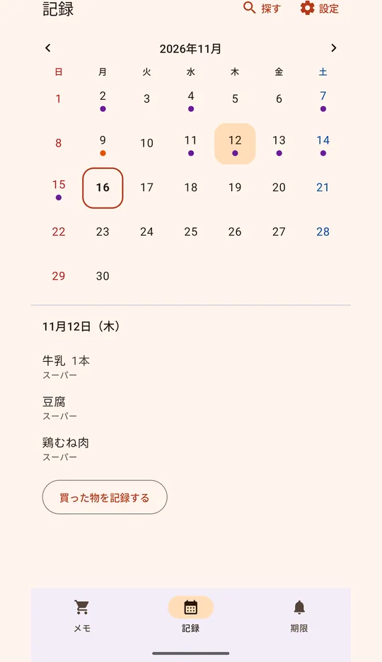

# クローズドテスト参加のご案内

いくメモのクローズドテスト（公開前のお試し）に参加してくださる方へのご案内です。

## いくメモとは

話すだけで使える買い物メモのアプリです。

- 「牛乳とたまご」と話すと、2つに分かれてメモに入ります
- 買ったら右へ動かすだけで記録。カレンダーで振り返れます
- 使い切りたい物は、期限の前の日にお知らせします
- アカウント登録・広告はありません。アプリは通信しません。データは端末の中にだけ保存します

| 話して追加 | スワイプで買った | 記録のカレンダー |
| --- | --- | --- |
|  |  |  |

## なぜクローズドテストが必要か

Google Play では、個人の開発者がアプリを公開する前に、**12 人以上の方に 14 日間以上**試していただくことが求められています。
公開のために、ご協力をお願いします。

## 参加していただく方へのお願い

- テストの期間中（14 日間以上）、アプリを入れたままにしてください
- 期間中に何回か開いて、ふだんの買い物で使ってみてください
- 気づいたことがあれば、気軽に知らせてください（下の「感想・不具合の報告先」）

## 必要なもの

- Android 8.0 以降のスマートフォン
- Google Play を使える Google アカウント

マイクや通知の許可は、使うときに求めます。許可しなくても、文字で入れればすべての機能を使えます。

## 参加手順

### STEP 1：テスター用のグループに参加する

下記のグループを開き、「グループに参加」を押します。承認待ちはなく、すぐに参加できます。

- グループの URL：<https://groups.google.com/g/ikumemo-testers>

**Google Play で使っている Google アカウントで参加してください。** 別のアカウントで参加すると、次の STEP でテスト版を入れられません。

参加のダイアログは、表示名などを変えずにそのまま「グループに参加」を押してください。ダイアログの見出しに `Undefined parameter` と
出ることがありますが、Google 側の表示の問題で、参加には影響しません。

参加した後、グループのページで「権限がありません」と出るのは正常です。テスター同士のやりとりが起きないよう、会話を見られない設定にしているためです。

### STEP 2：テストに参加する

グループに参加した Google アカウントで、テストへの参加ページを開き、「テスターになる」を押します。

- 参加ページの URL：<https://play.google.com/apps/testing/com.ikumemo.mobile>

グループへの参加が反映されるまで数分かかることがあります。「このテストに参加する資格がありません」と出たときは、少し時間をおいてから開き直してください。

### STEP 3：インストールする

参加ページの「Google Play でダウンロード」から、いくメモをインストールします。反映まで数時間かかることがあります。

### STEP 4：使ってみる

初めて開くと短い案内が出ます。使い方は、アプリの「設定」→「使い方」でいつでも見られます。

### STEP 5：期間中に何回か開く

14 日間が終わるまで、アプリを消さずに、ときどき開いてください。

## 感想・不具合の報告先

アプリの「設定」→「このアプリについて」→「ご意見・ご要望」から送れます。

- GitHub（開発の記録を公開している場所）で送れます。どなたでも見られる場所なので、お名前やメールアドレスなど、ご本人が分かることは書かないでください
- ご意見フォーム（GitHub を使わずに送れるもの）は、「ご意見フォームで送る」から開きます。ブラウザで Google フォームが開き、
  アプリの版・Android の版・機種名が自動で入ります（開くときにページの URL に含まれて GitHub と Google に届きます）。
  ご意見の内容が送られるのは、ご自身で送信ボタンを押したときだけです

個別のお返事はしていません。直したことはリリースノートでお知らせします。

## 退会方法

テストの参加ページで「テストから退出」を押し、Google グループから退会してください。アプリはそのまま使い続けることも、
アンインストールすることもできます。

## メールアドレスの扱いについて

- Google Play がテスターを見分けるため、参加には Google アカウント（メールアドレス）が必要です
- 開発者がメールアドレスを集めたり保管したりすることはありません。参加も退会も、ご自身の操作で済みます
- グループの管理画面では、開発者にはメンバーのメールアドレスが見えます。これを取り出して別の用途に使うことはありません
- メンバー同士では、お互いのメールアドレスは見えません。投稿もできない設定のため、グループからメールは届きません
- アプリ自体は、メールアドレスを含めて情報を外へ送りません（[プライバシーポリシー](store/PRIVACY_POLICY.md)）

## 関連ドキュメント

- [使い方（USER_GUIDE.md）](USER_GUIDE.md)
- [サポート情報（SUPPORT.md）](SUPPORT.md)
- [リリースノート（RELEASE_NOTES.md）](RELEASE_NOTES.md)
